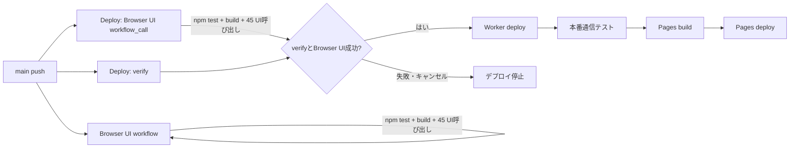
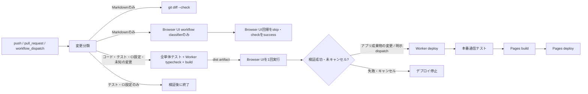

# CI・Browser UI回帰の重複実行と時間計測 — Issue #15

## 変更前の実行経路

`Browser UI verification` は `main` へのpushで単体テスト・build・Chromium／WebKitのUI回帰を実行します。同じpushで `Deploy` も起動し、`verify`（単体テスト・Worker typecheck・build）と再利用した `Browser UI verification`（単体テスト・build・UI回帰）が並列に始まります。検証が揃うとWorkerをデプロイし、本番通信検証、Pages build、Pages deployへ進みます。



Browser UIは独立したpush workflowとDeploy内の`workflow_call`で二重実行され、Browser側の単体テストとbuildもDeployの`verify`と重複していました。`Deploy`の`paths-ignore`はテスト専用ファイルを避けていましたが、workflow設定自身も除外対象に含まれていたため、デプロイworkflowの変更時にそのworkflowが起動しないケースがありました。文書だけのpushでは独立Browser UI workflowが起動し、Deploy側も一部のMarkdown変更で再デプロイしていました。

## 新しい実行経路



- `main`のpushは`Deploy`だけがBrowser UIを呼びます。Browser UI workflowのpushトリガーから`main`を外し、PR・既存の作業ブランチpush・手動実行は独立workflowで維持しました。
- `verify`が単体テスト・Worker typecheck・buildを1回実行し、成功した`dist`をartifact化します。Deployから呼ぶBrowser UIはこのbuildを取得し、単体テストとbuildを繰り返しません。Pages用Worker URL注入buildは、デプロイ後に必要な別buildとして残します。
- Deployは変更分類、`verify`、Browser UIの全結果が成功した場合だけWorkerへ進みます。キャンセル・失敗・スキップは成功条件を満たさず、Worker／Pages deployを許可しません。
- `workflow_dispatch`はデフォルトで全検証のみです。`deploy_to_production: true`を明示して初めて本番デプロイへ進みます。
- 変更分類workflowは常に起動するため、workflow-levelの`paths`／`paths-ignore`で必須checkをPendingに残す構成を避けています。Markdownのみの変更でもDeploy側の分類・`git diff --check`に加え、Browser UIのreusable workflow内で分類を実行し、Browser UI jobをskip成功にして既存check名を維持します。ブランチ保護のrequired-check設定そのものはGitHub接続APIから確認できませんでした。

## 変更分類と文書変更

`.github/scripts/classify-changes.mjs`はNUL区切りのGit差分パスを分類します。Git差分ではrename検出を無効にし、旧ファイルと新ファイルの両方を見ます。全変更が`.md`なら全回帰とデプロイを省略します。Markdownとコードの同時変更は通常の全検証に進みます。`tests/**`、`.github/**`、scriptのみの`package.json`変更は全検証を行い、アプリを公開しません。依存関係lockfileなどこれ以外の非Markdown変更は未知のファイルを含めてデプロイ対象にする安全側の扱いです。差分を計算できない場合や変更ゼロの場合も全検証・デプロイ対象として扱います。

文書固有の検証は`docs-check` jobの`git diff --check`です。Markdown lint等の別の既存文書検査はリポジトリにありませんでした。変更ファイル分類テストは`npm test`に含め、docs-only、コード併記、rename、テスト／CI変更、未知のファイル、判定不能時の条件を確認します。

## 高速テスト

単体テストファイルを1つだけ実行できます。

```sh
npm run test:file -- tests/step14-0-1.test.ts
```

Browser UIのスクリプトを1つ実行できます。Browser UI workflowと同じように、先にVite（4173）とbuild済みpreview（4174）を起動してください。

```sh
npm run build
VITE_ONLINE_API_URL=https://online-mock.invalid npm run dev -- --host 127.0.0.1 --port 4173 --strictPort
npm run preview -- --host 127.0.0.1 --port 4174 --strictPort
npm run test:browser -- --script tests/browser-online-waiting-room.py
npm run test:browser -- --script tests/browser-app-idle.py --browser webkit
npm run test:browser -- --script tests/browser-app-idle.py --browser both
```

対象スクリプトに manifest 上のChromium／WebKit両方の実行がある場合だけ`both`を指定できます。対応のないengineを要求するとrunnerはエラーになります。Browser runnerはログに開始・終了UTC時刻、秒単位時間、成功／失敗／タイムアウト／キャンセルを出し、既定で`/tmp/heibon-browser-ui-timings.csv`へ45件分の結果を書きます。失敗前に開始されなかったスクリプトは`skipped`として記録します。Browser UI artifactにも`heibon-browser-ui-timings.csv`が入ります。Playwrightケース単位の所要時間は未計測です。

高速テストは本番deploy経路から呼ばれず、成功だけでdeploy条件を満たせません。

## 正式リリース検証

mainへアプリ成果物を変更するpushでは、全単体・結合テスト、Worker typecheck、Pages build、45呼び出しのChromium／WebKit Browser UI回帰を実行します。成功artifactをBrowser UIが使います。Worker deployの後で本番通信テスト、Worker URLを埋め込んだPages build、Pages deployを順に実行します。Browser UIの画面幅・オンライン／オフライン・再接続・CPU手番などの既存シナリオは削除・緩和していません。iPhone Safari実機確認は自動ブラウザー検証に含まれません。

## 変更前後の実行時間・run数

比較対象run `40730187307`（Browser UI）と`40730187445`（Deploy）のジョブログを取得しました。両ログは同じcommit `04e394c6554512f912adff52beaef48b55c7520a`をcheckoutし、両方のBrowser UI jobが成功しています。

| 指標 | 確認結果 |
| --- | ---: |
| Actions workflow run数 | 2（Browser UI 1、Deploy 1） |
| 同一SHAの全Browser UI回帰 | 2回（各45呼び出し、計90呼び出し） |
| Browser UI単独jobのrunner経過 | 18分43.9秒 |
| Deploy内Browser UI jobのrunner経過 | 17分57.0秒 |
| 2 run内全7 jobのrunner経過の合計 | 約45分07.5秒 |
| 2 runをまたぐrunnerログの最初から最後まで | 約24分06.3秒 |
| 全必須検証完了まで | 約18分44秒（最初のrunnerログ時刻から独立Browser UIのjob完了まで） |
| pushから検証完了まで | 未計測（push時刻を取得できず） |
| pushからデプロイ完了まで | 未計測（push時刻を取得できず） |
| 文書のみ変更で起きた過去の不要run | Issue #15の調査記録では全CI・再deployが発生。対象2 runでの文書のみケースは未計測 |

変更後はCI設定・テスト・package scriptsのみのcommit `f1ab679c5ae19c40e6f2fcb9937abe64ffef01bf` をpushしました。Deploy run [`40775396476`](https://github.com/ak-sekine/heibon-mahjong/actions/runs/40775396476)は成功し、デプロイ条件は`validation-only`でした。

| 指標 | 変更後の実測 |
| --- | ---: |
| Actions workflow run数 | 1（Deploy run。Browser UIは同じrun内のreusable job） |
| 同一SHAの全Browser UI回帰 | 1回、45呼び出し |
| Browser UI jobのrunner経過 | 17分35秒 |
| Browser UI script総経過 | 16分24.9秒（CSVの45行） |
| script結果 | 成功45、失敗0、timeout 0、skip 0 |
| Chromium／WebKit | Chromium 30呼び出し・10分00.0秒、WebKit 15呼び出し・6分24.8秒 |
| 最長script | `browser-round-end-ui.py` WebKit 2分59.8秒、同Chromium 1分37.5秒 |
| その他の長時間script | `browser-riichi-discard-layout.py` Chromium 1分47.7秒、`browser-river-capacity.py` WebKit 1分06.2秒、通常の`browser-online-waiting-room.py` Chromium 1分05.7秒 |
| 検証用jobのrunner時間合計 | 18分46秒（分類9秒、文書check 11秒、verify 51秒、Browser UI 17分35秒） |
| Actions run作成から全検証完了まで | 18分45秒（21:51:39作成、22:10:24 Browser UI完了） |
| Worker／Pages再デプロイ | 実行なし（テスト・CI変更commitをclassifierが`validation-only`に分類） |
| pushから検証完了まで | 未計測（pushイベント時刻の正確な取得なし。run作成からの経過を記載） |
| pushからデプロイ完了まで | 未計測（このcommitではdeployなし） |
| Chromium／WebKit script別結果Artifact | `browser-ui-f1ab679c5ae19c40e6f2fcb9937abe64ffef01bf-1`、ID `12854494447` |

変更前の全7 job runner時間は45分07.5秒でした。うち全検証job（独立Browser UI、Deploy verify、Deploy内Browser UI）は39分24.3秒です。変更後は検証job合計18分46秒で、検証runner時間は20分38.3秒（約52%）減りました。Actions run数と同一SHAのBrowser UI回帰はそれぞれ2→1、2→1です。

壁時計の検証完了は、変更前run群の最初のrunner logから必須Browser UI終了まで約18分44秒、変更後はActions run作成から必須Browser UI終了まで約18分45秒で、実質短縮は確認できません。変更前の各jobは並行起動されており、重複run削減はrunner時間を減らしましたが、検証全体の待ち時間は短縮しませんでした。変更前後のBrowser UI regression stepは16分33秒／16分13秒（Issue記録）と16分24.9秒（今回実測）で、個々の回帰実行自体にも短縮はありません。

今回のcommitはアプリ成果物を変えていないためWorker deploy・本番通信テスト・Pages build/deployは実行していません。したがって実デプロイ時間の前後比較は未計測です。ローカルのpush時刻も正確には取れなかったので、push-to-verifyとpush-to-deployはrun作成時刻の代理値で置き換えていません。

## 未解決事項とリスク

- GitHub branch protection / rulesetのrequired checksは未確認です。`gh api repos/ak-sekine/heibon-mahjong/branches/main/protection`は通常sandboxでproxy接続を拒否され、承認付きの再試行も`403 Resource not accessible by integration`でした。workflow-level path filterを使わずjobをskipするためGitHub Actions上はcheck自体が作成されますが、実際の保護ルールとの突合は未確認です。
- Issue #7のBrowser UI timeoutと、記録されている過去のオンラインCPU手番進行テスト失敗は今回の変更では削除・skip・timeout緩和していません。変更後のローカル`npm test`は65 test files、65成功、0失敗（うち`step14-0-1.test.ts`単独も成功）です。`npm run build`、`npm run typecheck:worker`、workflow YAML構文確認、Browser runnerのPython compile、`git diff --check`も成功しました。Issue #7の過去Browser UI timeout原因は未解決です。
- 初回workflow実行でartifact共有、条件式、GitHub Actionsのcheck名、Browser UI全回帰は成功しました。アプリ変更を含む実デプロイ経路は今回未実行です。
- 文書のみのworkflow dispatch/push、手動の本番deploy、失敗・cancel経路の実デプロイは行っていません。条件classifierのテストとdeploy jobのsuccess条件を静的検査しました。iPhone Safari実機確認は未実施です。
