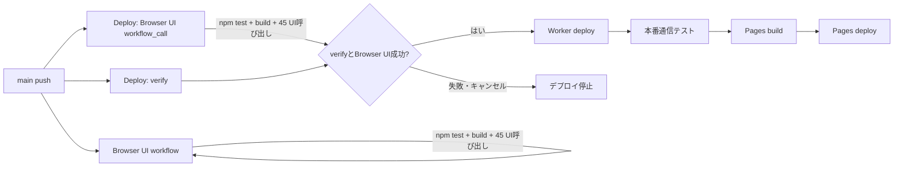
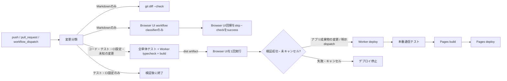

# CI・Browser UI回帰の重複実行と時間計測 — Issue #15

## 変更前の実行経路

`Browser UI verification` は `main` へのpushで単体テスト・build・Chromium／WebKitのUI回帰を実行します。同じpushで `Deploy` も起動し、`verify`（単体テスト・Worker typecheck・build）と再利用した `Browser UI verification`（単体テスト・build・UI回帰）が並列に始まります。検証が揃うとWorkerをデプロイし、本番通信検証、Pages build、Pages deployへ進みます。



Browser UIは独立したpush workflowとDeploy内の`workflow_call`で二重実行され、Browser側の単体テストとbuildもDeployの`verify`と重複していました。`Deploy`の`paths-ignore`はテスト専用ファイルを避けていましたが、workflow設定自身も除外対象に含まれていたため、デプロイworkflowの変更時にそのworkflowが起動しないケースがありました。文書だけのpushでは独立Browser UI workflowが起動し、Deploy側も一部のMarkdown変更で再デプロイしていました。

## 新しい実行経路



- `main`のpushは`Deploy`だけがBrowser UIを呼びます。Browser UI workflowのpushトリガーから`main`を外し、PR・既存の作業ブランチpush・手動実行は独立workflowで維持しました。
- `verify`が単体テスト・Worker typecheck・buildを1回実行し、成功した`dist`をartifact化します。Deployから呼ぶBrowser UIはこのbuildを取得し、単体テストとbuildを繰り返しません。Pages用Worker URL注入buildは、デプロイ後に必要な別buildとして残します。
- Deployは変更分類、`verify`、Browser UIの全結果が成功した場合だけWorkerへ進みます。キャンセル・失敗・スキップは成功条件を満たさず、Worker／Pages deployを許可しません。
- `workflow_dispatch`はデフォルトで全検証のみです。`deploy_to_production: true`を明示して初めて本番デプロイへ進みます。
- 変更分類workflowは常に起動するため、workflow-levelの`paths`／`paths-ignore`で必須checkをPendingに残す構成を避けています。Markdownのみの変更でもDeploy側の分類・`git diff --check`に加え、Browser UIのreusable workflow内で分類を実行し、Browser UI jobをskip成功にして既存check名を維持します。ブランチ保護のrequired-check設定そのものはGitHub接続APIから確認できませんでした。

## 変更分類と文書変更

`.github/scripts/classify-changes.mjs`はNUL区切りのGit差分パスを分類します。Git差分ではrename検出を無効にし、旧ファイルと新ファイルの両方を見ます。全変更が`.md`なら全回帰とデプロイを省略します。Markdownとコードの同時変更は通常の全検証に進みます。`tests/**`、`.github/**`、scriptのみの`package.json`変更は全検証を行い、アプリを公開しません。依存関係lockfileなどこれ以外の非Markdown変更は未知のファイルを含めてデプロイ対象にする安全側の扱いです。差分を計算できない場合や変更ゼロの場合も全検証・デプロイ対象として扱います。

文書固有の検証は`docs-check` jobの`git diff --check`です。Markdown lint等の別の既存文書検査はリポジトリにありませんでした。変更ファイル分類テストは`npm test`に含め、docs-only、コード併記、rename、テスト／CI変更、未知のファイル、判定不能時の条件を確認します。

## 高速テスト

単体テストファイルを1つだけ実行できます。

```sh
npm run test:file -- tests/step14-0-1.test.ts
```

Browser UIのスクリプトを1つ実行できます。Browser UI workflowと同じように、先にVite（4173）とbuild済みpreview（4174）を起動してください。

```sh
npm run build
VITE_ONLINE_API_URL=https://online-mock.invalid npm run dev -- --host 127.0.0.1 --port 4173 --strictPort
npm run preview -- --host 127.0.0.1 --port 4174 --strictPort
npm run test:browser -- --script tests/browser-online-waiting-room.py
npm run test:browser -- --script tests/browser-app-idle.py --browser webkit
npm run test:browser -- --script tests/browser-app-idle.py --browser both
```

`--browser chromium`または`--browser webkit`でmanifest内の全scenarioをengine別に選べます。`--script`と組み合わせる場合も、対応のないengineを要求するとrunnerはエラーになります。`--browser both`は全engineを選びます（`--script`と併用する場合はそのscriptの両engine実行が必要です）。Browser runnerはログに開始・終了UTC時刻、秒単位時間、成功／失敗／タイムアウト／キャンセルを出し、既定で`/tmp/heibon-browser-ui-timings.csv`へ結果を書きます。失敗前に開始されなかったスクリプトは`skipped`として記録します。Browser UI artifactにもtiming CSVが入ります。Playwrightケース単位の所要時間は未計測です。

高速テストは本番deploy経路から呼ばれず、成功だけでdeploy条件を満たせません。

## 正式リリース検証

mainへアプリ成果物を変更するpushでは、全単体・結合テスト、Worker typecheck、Pages build、45呼び出しのChromium／WebKit Browser UI回帰を実行します。成功artifactをBrowser UIが使います。Worker deployの後で本番通信テスト、Worker URLを埋め込んだPages build、Pages deployを順に実行します。Browser UIの画面幅・オンライン／オフライン・再接続・CPU手番などの既存シナリオは削除・緩和していません。iPhone Safari実機確認は自動ブラウザー検証に含まれません。

## 変更前後の実行時間・run数

比較対象run `40730187307`（Browser UI）と`40730187445`（Deploy）のジョブログを取得しました。両ログは同じcommit `04e394c6554512f912adff52beaef48b55c7520a`をcheckoutし、両方のBrowser UI jobが成功しています。

| 指標 | 確認結果 |
| --- | ---: |
| Actions workflow run数 | 2（Browser UI 1、Deploy 1） |
| 同一SHAの全Browser UI回帰 | 2回（各45呼び出し、計90呼び出し） |
| Browser UI単独jobのrunner経過 | 18分43.9秒 |
| Deploy内Browser UI jobのrunner経過 | 17分57.0秒 |
| 2 run内全7 jobのrunner経過の合計 | 約45分07.5秒 |
| 2 runをまたぐrunnerログの最初から最後まで | 約24分06.3秒 |
| 全必須検証完了まで | 約18分44秒（最初のrunnerログ時刻から独立Browser UIのjob完了まで） |
| pushから検証完了まで | 未計測（push時刻を取得できず） |
| pushからデプロイ完了まで | 未計測（push時刻を取得できず） |
| 文書のみ変更で起きた過去の不要run | Issue #15の調査記録では全CI・再deployが発生。対象2 runでの文書のみケースは未計測 |

変更後はCI設定・テスト・package scriptsのみのcommit `f1ab679c5ae19c40e6f2fcb9937abe64ffef01bf` をpushしました。Deploy run [`40775396476`](https://github.com/ak-sekine/heibon-mahjong/actions/runs/40775396476)は成功し、デプロイ条件は`validation-only`でした。

| 指標 | 変更後の実測 |
| --- | ---: |
| Actions workflow run数 | 1（Deploy run。Browser UIは同じrun内のreusable job） |
| 同一SHAの全Browser UI回帰 | 1回、45呼び出し |
| Browser UI jobのrunner経過 | 17分35秒 |
| Browser UI script総経過 | 16分24.9秒（CSVの45行） |
| script結果 | 成功45、失敗0、timeout 0、skip 0 |
| Chromium／WebKit | Chromium 30呼び出し・10分00.0秒、WebKit 15呼び出し・6分24.8秒 |
| 最長script | `browser-round-end-ui.py` WebKit 2分59.8秒、同Chromium 1分37.5秒 |
| その他の長時間script | `browser-riichi-discard-layout.py` Chromium 1分47.7秒、`browser-river-capacity.py` WebKit 1分06.2秒、通常の`browser-online-waiting-room.py` Chromium 1分05.7秒 |
| 検証用jobのrunner時間合計 | 18分46秒（分類9秒、文書check 11秒、verify 51秒、Browser UI 17分35秒） |
| Actions run作成から全検証完了まで | 18分45秒（21:51:39作成、22:10:24 Browser UI完了） |
| Markdown-only run | [`40778150218`](https://github.com/ak-sekine/heibon-mahjong/actions/runs/40778150218)：32秒、成功 |
| Markdown-only時のCI | Deploy分類・Browser UI分類・両`git diff --check`は成功。`verify`、全Browser UI、Worker／Pages deployはskip |
| Worker／Pages再デプロイ | 実行なし（テスト・CI変更commitをclassifierが`validation-only`に分類） |
| pushから検証完了まで | 未計測（pushイベント時刻の正確な取得なし。run作成からの経過を記載） |
| pushからデプロイ完了まで | 未計測（このcommitではdeployなし） |
| Chromium／WebKit script別結果Artifact | `browser-ui-f1ab679c5ae19c40e6f2fcb9937abe64ffef01bf-1`、ID `12854494447` |

変更前の全7 job runner時間は45分07.5秒でした。うち全検証job（独立Browser UI、Deploy verify、Deploy内Browser UI）は39分24.3秒です。変更後は検証job合計18分46秒で、検証runner時間は20分38.3秒（約52%）減りました。Actions run数と同一SHAのBrowser UI回帰はそれぞれ2→1、2→1です。

壁時計の検証完了は、変更前run群の最初のrunner logから必須Browser UI終了まで約18分44秒、変更後はActions run作成から必須Browser UI終了まで約18分45秒で、実質短縮は確認できません。変更前の各jobは並行起動されており、重複run削減はrunner時間を減らしましたが、検証全体の待ち時間は短縮しませんでした。変更前後のBrowser UI regression stepは16分33秒／16分13秒（Issue記録）と16分24.9秒（今回実測）で、個々の回帰実行自体にも短縮はありません。

Markdownのみの検証記録commit `eb3930ea78f4966e8be6da10dbad64cd92f0f1b3` のrun `40778150218`では、両classifierが`docs-only`・`run_full_suite=false`・`deploy_required=false`を出し、両方の`git diff --check`が成功しました。`verify`、Browser UI job、Worker deploy、本番通信テスト、Pages build/deployはGitHub Actions上でskipとして完了し、run全体は成功しました。今回のCI設定・テスト変更commitでもWorker deploy・本番通信テスト・Pages build/deployは実行していません。したがって実デプロイ時間の前後比較は未計測です。ローカルのpush時刻も正確には取れなかったので、push-to-verifyとpush-to-deployはrun作成時刻の代理値で置き換えていません。

## 未解決事項とリスク

- GitHub branch protection / rulesetのrequired checksは未確認です。`gh api repos/ak-sekine/heibon-mahjong/branches/main/protection`は通常sandboxでproxy接続を拒否され、承認付きの再試行も`403 Resource not accessible by integration`でした。workflow-level path filterを使わずjobをskipするためGitHub Actions上はcheck自体が作成されますが、実際の保護ルールとの突合は未確認です。
- Issue #7のBrowser UI timeoutと、記録されている過去のオンラインCPU手番進行テスト失敗は今回の変更では削除・skip・timeout緩和していません。変更後のローカル`npm test`は65 test files、65成功、0失敗（うち`step14-0-1.test.ts`単独も成功）です。`npm run build`、`npm run typecheck:worker`、workflow YAML構文確認、Browser runnerのPython compile、`git diff --check`も成功しました。Issue #7の過去Browser UI timeout原因は未解決です。
- 初回workflow実行でartifact共有、条件式、GitHub Actionsのcheck名、Browser UI全回帰は成功しました。アプリ変更を含む実デプロイ経路は今回未実行です。
- 文書のみのworkflow dispatch/push、手動の本番deploy、失敗・cancel経路の実デプロイは行っていません。条件classifierのテストとdeploy jobのsuccess条件を静的検査しました。iPhone Safari実機確認は未実施です。


## 本番デプロイ経路の再確認（2026-10-28）

### 対象と確認区分

- GitHub APIで確認したmain SHA: `16985778886bfeb781357940db98defe930bf6ef`。通常の `git fetch origin main` は実行環境のproxy接続失敗で取得できませんでした。GitHub APIのmain commitと同SHAのworkflow／文書を読み取りました。
- 静的検査: `.github/workflows/deploy.yml`、`.github/workflows/browser-ui.yml`、`.github/scripts/classify-changes.mjs`、`wrangler.jsonc`、`package.json`を確認。
- GitHub Actions履歴: #357（`f1ab679c5ae19c40e6f2fcb9937abe64ffef01bf`）、#358（`eb3930ea78f4966e8be6da10dbad64cd92f0f1b3`）、#359（`16985778886bfeb781357940db98defe930bf6ef`）のrun/job/artifact情報を確認。
- 本番デプロイ: 新CI導入後のアプリコード変更によるWorker／Pagesデプロイ履歴は確認できませんでした。今回、新しいデプロイは実行していません。
- ライブ稼働状態: GitHub Actions上の最後の成功記録は確認しましたが、この実行環境の送信先制限により公開Pages／Workerへ直接接続できず、現在の応答状態は未確認です。

### 現行デプロイ経路の静的検査

`main` pushではDeploy workflowが常に変更分類と`docs-check`を開始します。Markdown以外の変更では`verify`が`npm test`、`npm run typecheck:worker`、`npm run build`を実行し、成功した`dist`を`pages-dist-<github.sha>-<run_attempt>`名で保存します。Deployから呼ぶBrowser UI workflowは同じSHA／run attempt名のartifactを取得して45呼び出しのChromium／WebKit回帰を実行します。

Worker deployの条件は`deploy_required == true`、`verify.result == success`、`browser-ui.result == success`です。いずれかの失敗・キャンセル・skip、変更分類失敗、またはBrowser UIのartifact download失敗では条件を満たしません。Worker deployは`github.sha`をcheckoutします。PagesはWorker deployと本番通信テストの成功後に同じSHAをbuildし、デプロイ済みWorker URLがJS bundleに含まれることを確認してPages artifactを作成し、その後`actions/deploy-pages`で公開します。Browser UIが使う検証済みartifactと、Worker URLを埋め込んだPages用artifactは別のbuildです。

以下は静的検査で確認した制限・未確認事項です。

- 本番通信テストはWorker deploy後に実行されます。その成功はPages build／deployをゲートしますが、既に開始されたWorker deployを事前にゲートする検証ではありません。
- `docs-check`は`deploy-worker.needs`に含まれず、Worker deployを直接ゲートしません。GitHub branch protection／rulesetのrequired checks endpointは403 `Resource not accessible by integration`となり、`docs-check`や他jobがrequiredかは未確認です。
- Browser用artifact名はSHAとrun attemptに結び付き、現runからその名前で取得します。別SHA名のartifactは取得できずjob失敗になります。ただしartifact内容を独立したSHA-256 manifestと照合する検証はworkflowにありません。
- `workflow_dispatch`は`deploy_to_production: true`を明示しない限りdeployしませんが、workflow自体にmain ref限定条件はありません。将来手動実行で検証する場合はmain refを選ぶ必要があります。
- 意図的に失敗するコードをpushせず、現行workflowでの失敗／キャンセル経路は静的条件とjob依存関係で確認しました。現行workflow上でこれらの失敗を実環境再現した結果ではありません。

### GitHub Actions履歴での確認

- Deploy #357は成功。SHA `f1ab679c5ae19c40e6f2fcb9937abe64ffef01bf`で単体テスト、Worker型チェック、Pages build、45呼び出しのBrowser UIが成功し、Browser UIが同runの`pages-dist-f1ab...-1`をdownloadしました。classifierの分類はvalidation-onlyでWorker／Pages deployはskipでした。そのため、新CIの全検証成功とartifact受け渡しは履歴で確認できますが、アプリ変更によるdeploy経路は確認できません。
- Deploy #358と#359はいずれもdocs-onlyとして成功し、`verify`、Browser UI回帰、Worker／Pages deployはskipでした。
- 新CI導入前のDeploy #355はSHA `04e394c6554512f912adff52beaef48b55c7520a`で、verify、Browser UI、Worker deploy、本番通信テスト、Pages build、Pages deployがすべて成功していました。Worker deployと本番通信テストの対象SHAは同SHAでした。#356はBrowser UI内の`npm test`失敗でWorker／Pages deployがskipでした。Issue #7の報告ではオンラインCPU手番進行テスト2件の失敗です。#356は新CI定義導入前のrunです。
- GitHub compare上、#355のSHAから現在のmainまでに変更されたファイルはCI、文書、package scripts、テスト用runner／分類テストで、ゲームのアプリ／Workerソースは含まれていません。これはリポジトリ内容の比較であり、稼働中本番への直接probeではありません。

### 本番状態と未確認事項

#355の本番通信テストは2026-10-28 17:13 UTCに成功し、Pages deployは17:16 UTCに成功しました。これがGitHub Actionsから確認できた最後の本番成功記録です。#356以降、本番deploy成功のActions履歴はありません。公開Pages／Workerの現在のHTTP応答を直接確認できなかったため、現在の稼働正常性は未確認です。

CI高速化後のアプリコード変更deploy、現在の本番HTTP応答、required checks設定、失敗／キャンセル経路の実環境再現、実機操作は未確認です。Issue #15はこれらが残るためOpenのままです。Issue #7の失敗を解決済みとは扱いません。

## 実アプリ変更と本番デプロイの確認（2026-10-29）

### 確認対象

Issue #5「新規対局時のランダム座席」の実装・修正に伴うmainのpushと、完了記録のみを変更したdocs-only pushをGitHub Actions上で確認しました。以下はGitHub Actionsのrun/job/step履歴から確認した過去の実行結果であり、この記録作成時に再実行した結果ではありません。

### アプリ変更時のrun

| Run | SHA・変更 | 成功したjob | スキップされた処理と理由 |
| --- | --- | --- | --- |
| [40806362450](https://github.com/ak-sekine/heibon-mahjong/actions/runs/40806362450) | SHA cb1bb8f4dd99627aa308b84db3a64852ff06e135。座席ランダム化後の検証用座席を安定させる変更。 | detect-changes、docs-check、verify（全回帰テスト、Worker typecheck、Pages build、検証済みbuild artifact保存）、browser-ui / browser-ui、deploy-worker、production-test、pages-build、pages-deploy。 | reusable Browser UI内のclassifierと文書check jobはreuse_build=trueで呼ばれたためskip。Browser UI job内のunit testとbuild stepもskipし、SHAとrun attemptが一致するpages-dist artifactをdownloadして回帰を実施。これらは実行済みの親workflow検証を再利用したため。 |
| [40813350867](https://github.com/ak-sekine/heibon-mahjong/actions/runs/40813350867) | SHA c127ca3d949b35834aba72d00f938f25314a7f37。オンラインで座席を確定してから対局を開始するIssue #5の実装。 | detect-changes、docs-check、verify（全回帰テスト、Worker typecheck、Pages build、検証済みbuild artifact保存）、browser-ui / browser-ui、deploy-worker、production-test、pages-build、pages-deploy。 | reusable Browser UI内のclassifierと文書check jobはreuse_build=trueで呼ばれたためskip。Browser UI job内のunit testとbuild stepもskipし、検証済みartifactを再利用して回帰を実施。 |

両runともclassifierはrun_full_suite=true、deploy_required=trueを出力しました。browser-ui job logでは各47件すべてがsuccessで、Chromium 31件・WebKit 16件、timeout 0でした。job履歴ではverifyとBrowser UIが成功した後にWorker deployが成功し、その後production test、Pages build、Pages deployが順に成功しています。Production testはHTTPS、room、WebSocket、再接続、認証、privacy検証stepが成功しました。したがって、CI最適化後の座席機能に関する実アプリ変更でWorkerとPagesが本番デプロイされ、本番通信検証も成功したことを確認しました。

### 関連するvalidation-only run

[Run 40813562264](https://github.com/ak-sekine/heibon-mahjong/actions/runs/40813562264)（SHA c27856e157c601ced0a400f177bb6fdcdc26a450）では、detect-changesとdocs-check、verify、Chromium／WebKit Browser UIが成功しました。browser-ui job logは47件success（Chromium 31、WebKit 16、timeout 0）でした。Browser UI jobは検証済みbuildをdownloadし、unit test/buildの重複stepはskipしました。分類ログはrun_full_suite=true、deploy_required=false、classification=validation-onlyです。このrunのcommitは.github/workflows/production-diagnostics.ymlだけを変更しており、deploy-worker、production-test、pages-build、pages-deployはすべてskipでした。reusable Browser UI内のclassifierと文書checkもreuse_build=trueによりskipしました。変更分類どおりのskipであり、未実行のデプロイ処理を成功とは扱いません。

### docs-only run

[Run 40847470010](https://github.com/ak-sekine/heibon-mahjong/actions/runs/40847470010)（SHA 9665defc0cec70cc90260a34af258eb0092f101a）はrun全体がsuccessでした。detect-changesとdocs-checkのgit diff --checkは成功し、reusable Browser UI側のclassifierと文書checkも成功しました。verify、browser-ui / browser-ui、deploy-worker、production-test、pages-build、pages-deployはjob単位でskipでした。docs-only classifierが全回帰とWorker／Pagesデプロイを除外した実例です。アプリ関連jobや本番デプロイを実行したとは記録しません。

### 現行workflowの構成（静的確認）

2026-10-29に取得したGitHub main SHA 9665defc0cec70cc90260a34af258eb0092f101aの.github/workflows/deploy.yml、browser-ui.yml、変更分類scriptを確認しました。以下はworkflow定義から読める構成です。

- main pushはDeploy workflowがBrowser UI reusable workflowを1回呼びます。独立Browser UI workflowはmain pushを対象にせず、PR・指定ブランチpush・手動実行を対象にします。
- verifyがnpm test、Worker typecheck、npm run buildを実行し、成功したdistをSHAとrun attemptを含むartifact名で保存します。Deployから呼ぶBrowser UIは同じ名前のartifactを取得するため、unit testとbuildを二重実行しません。Run 40806362450と40813350867では、このdownload stepと後続のChromium／WebKit回帰stepの成功も確認しました。
- Browser UIのPlaywright installはChromiumとWebKitを指定し、登録された回帰を実行します。Run 40806362450、40813350867、40813562264では各47件（Chromium 31、WebKit 16）がsuccess、timeout 0でした。以前の時間比較に記載した45件は異なるrunでの実測です。現行YAMLだけでは実行時のケース個別結果までは断定せず、run artifact/logの結果に基づいて確認します。
- docs-only分類ではdocs-checkを維持し、全アプリ検証、Browser UI、WorkerとPagesのdeployをskipします。Run 40847470010はこの実動作を示しています。
- Worker deployは変更分類がdeploy対象で、verifyとBrowser UIがsuccessの場合に進みます。Worker本番通信テスト成功後にPages buildし、最後にPagesをdeployします。Run 40806362450と40813350867はこの順序で全jobがsuccessでした。
- Pages向けにはWorker URLを注入して別途buildします。これは検証済みBrowser UI buildの重複ではなく、デプロイWorker URLが入った公開bundleを作るためのbuildです。

### 効果の実測値と範囲

この記録の「変更前後の実行時間・run数」節にある同一SHA比較（変更前run 40730187307／40730187445、変更後run 40775396476）を再確認しました。実測では同一SHAのBrowser UI回帰は2回・90呼び出しから1回・45呼び出しに減り、全検証jobのrunner時間合計は39分24.3秒から18分46秒へ20分38.3秒（約52%）減少しました。一方、必須検証完了までの壁時計時間は約18分44秒から約18分45秒で、短縮は確認されませんでした。これはその節に記載した各run・測定条件に限った比較です。2026-10-29の3コードrunについては実行時間削減率を算出していません。

### Branch protectionとRequired Checks

今回、GitHub APIのGET /repos/ak-sekine/heibon-mahjong/branches/mainはprotected: false、protection disabled、required status check contextsなしを返し、GET /repos/ak-sekine/heibon-mahjong/rulesetsは空配列でした。branch protection詳細endpointは403 Resource not accessible by integrationで取得できませんでした。Issueコメントに記録済みのユーザーによる2026-10-29 Settings画面確認でもBranch protection rulesとrepository Rulesetsは未設定です。確認できた範囲ではリポジトリのbranch protection／repository rulesetsによるRequired Checksはありません。組織・上位階層のポリシーまでは確認していません。

Issue #15の受け入れ条件はActions内部の必須検証をdeploy gateにすることであり、新たなbranch protectionやRequired Checksの作成を要求していません。既存のmain直接push運用を維持し、ブランチ保護・Required Checksは追加・変更していません。

### 未確認事項・制約

- 意図的なテスト失敗・cancelを本番deployに通す実験はしていません。失敗・cancel・skipでdeploy条件を満たさないことはworkflow条件・依存関係の静的確認で判断し、実際の失敗履歴では確認していません。
- 本番通信テストはWorker deploy後に実行され、成功がPages build／deployの前提になります。これはWorker deploy前のゲートではありません。
- artifact名はSHAとrun attemptに結び付きますが、download後に内容のSHA-256 manifestを独立照合する仕組みはありません。
- 本番公開先への今回の直接HTTP probeは行っていません。ここでいう本番確認は、指定されたActions履歴内のWorker deploy、production-test、Pages deployの成功です。
- iPhone Safari実機検証はBrowser UI自動検証とは別であり、このCI検証の対象外です。

### Issue #15の完了判定

CI変更後の実アプリ変更run 40806362450と40813350867で、必要な自動検証、Chromium／WebKit Browser UI、Worker deploy、本番通信テスト、Pages deployの成功を確認しました。Run 40813562264はvalidation-onlyのデプロイskip、Run 40847470010はdocs-onlyの全アプリ検証・デプロイskipと文書check成功をそれぞれ示しました。以前の測定記録は重複run削減とrunner時間を実測し、壁時計時間が短縮したとはしていません。Branch protection確認はユーザー画面確認と今回のGitHub API応答を区別して記録しました。

以上より、Issue本文の必須受け入れ条件は満たされました。Required Checksの新規設定はIssueの必須条件ではなく、現行運用に合わせて変更していません。失敗／cancel経路の実環境再現、現在の公開URLへの直接probe、組織上位ポリシーは未確認として残し、成功実績と混同しません。Issue #15を「実環境検証済み・完了」と判定します。
